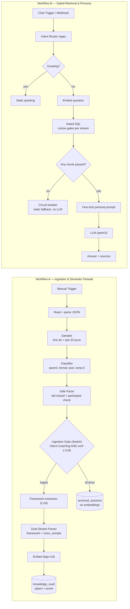

# Bounded Dual-Stream RAG & Ingestion Firewall (n8n + pgvector)

A local RAG pipeline in n8n backed by PostgreSQL 16 + pgvector. It has two workflows:

- **Workflow A, Ingestion & Semantic Firewall.** An LLM classifier gates every transcript. Only client-coaching sessions reach the vector store, as two streams: a dense *framework* takeaway, and verbatim *voice samples* of the coach.
- **Workflow B, Gated Retrieval & Persona Synthesis.** Greetings are intercepted with a regex. Cosine-similarity gates in raw SQL decide what can be retrieved. A zero-match circuit breaker never calls the LLM. Answers are written in the coach's voice using positive few-shot prompting.

Everything runs locally: n8n and Postgres in Docker, and models in Ollama on the host (`bge-m3` for embeddings, `qwen3:4b-instruct` for classification and generation).

---

## Quickstart

**Prerequisites:** Docker (with Compose v2), [Ollama](https://ollama.com) running on the host, `curl`, and `python3`. `python3` is used only by the verify script.

```bash
# 1. Models (bge-m3 → 1024-dim embeddings, qwen3:4b-instruct → JSON-mode LLM)
ollama pull bge-m3
ollama pull qwen3:4b-instruct

# 2. Clone and start. No .env needed; docker-compose.yml has local defaults (see .env.example)
git clone <this-repo> && cd n8n-rag-firewall
docker compose up -d
```

`docker compose up` does the following:

1. Starts **Postgres 16 + pgvector**. `init.sql` runs on the fresh volume and creates the `rag` database, the tables and the HNSW index.
2. Runs a one-shot **`n8n-import`** service ([scripts/n8n-bootstrap.sh](scripts/n8n-bootstrap.sh)). It creates the `Postgres (rag)` credential from environment variables, so no secrets are stored in git. It then imports both workflows with stable IDs and publishes Workflow B's webhook.
3. Starts **n8n 2.47.7** on <http://localhost:5678>.

```bash
# 3. Open http://localhost:5678 and create the local owner account (one-time n8n requirement).

# 4. Run the ingestion workflow and the full verification suite
./scripts/verify.sh --ingest
```

You can also run it from the UI: open **"A — Ingestion & Semantic Firewall"** and click **Execute workflow**. Then query Workflow B from the n8n chat panel (Chat Trigger), or with curl:

```bash
curl -s -X POST http://localhost:5678/webhook/ask \
  -H 'Content-Type: application/json' \
  -d '{"question": "How should I approach an underperforming VP?"}'
```

To reset everything, run `docker compose down -v && docker compose up -d`. `init.sql` and the bootstrap only run on fresh volumes.

---

## Repository layout

```
├── docker-compose.yml           # postgres (pgvector:pg16) + one-shot n8n-import + n8n
├── init.sql                     # rag DB, knowledge_vault, HNSW index, archived_sessions
├── workflows/
│   ├── ingestion_firewall.json  # Workflow A
│   └── gated_retrieval.json     # Workflow B
├── data/mock_transcripts.json   # the 4 sample sessions
├── scripts/
│   ├── n8n-bootstrap.sh         # credential + workflow import, publishes Workflow B
│   └── verify.sh                # reproduces the verification log below
└── README.md
```

---

## Architecture



### Database (`init.sql`)

| Object | Purpose |
|---|---|
| `rag` database | Keeps project tables separate from n8n's internal tables, which live in the `n8n` DB. |
| `knowledge_vault` | Columns: `id`, `session_id`, `stream_type` (`CHECK IN ('framework','voice_sample')`), `chunk_index`, `content`, `metadata JSONB`, `embedding vector(1024)`. `UNIQUE (session_id, stream_type, chunk_index)` makes re-ingestion idempotent. |
| `knowledge_vault_embedding_hnsw` | `USING hnsw (embedding vector_cosine_ops) WITH (m = 16, ef_construction = 64)`. Cosine ops match the `<=>` operator used at query time. |
| `archived_sessions` | Flat relational table for rejected sessions: classification, summary and participants. It deliberately has **no embedding column**. |

### Workflow A, node by node

1. **Sampler (Code).** Splits the file into one n8n item per session, `[{ json }]`, and keeps `turns.slice(0, 40)` plus `turns.slice(-20)`. Transcripts with 60 turns or fewer are taken whole, so no turn is duplicated.
2. **Classifier (HTTP → Ollama `/api/chat`).** Uses `format: "json"` and `temperature: 0`, and returns `{meeting_type, confidence_score, summary}`.
3. **Safe Parse (Code).** This node never throws. Invalid JSON, JSON wrapped in prose, an unknown label, a non-numeric score or a score outside [0, 1] all collapse to `Other / 0`, and the gate rejects them. The design is **fail-closed**: a broken classifier output cannot leak into the vault. The node also runs a deterministic consistency check: a session with no external participant cannot be `Client Coaching`.
4. **Ingestion Gate (Switch).** Output `Ingest` requires `meeting_type == "Client Coaching"` **AND** `confidence_score >= 0.80`. Everything else goes to the fallback output `Archive`, which runs an `INSERT … ON CONFLICT DO UPDATE` into `archived_sessions`.
5. **Framework extraction (LLM).** Produces Stream 1, a dense conceptual takeaway (name, core principle, decision logic, application). The same call also returns a short *retrieval context*: the client's situation and typical questions a leader would ask. That context is used only for embedding (see calibration below).
6. **Dual-Stream Parser (Code).**
   - **framework:** the safely parsed takeaway.
   - **voice_sample:** only the turns spoken by the coach (`is_team_member: true`), kept verbatim. Turns are split into sentences and packed greedily into 400–700 character chunks. Chunks are never cut mid-sentence, and each new turn starts on a new line to keep the speaking rhythm. A short tail chunk is merged into, or rebalanced with, its neighbour.
7. **Embed (bge-m3)** sends one batched request per session and validates that every vector has exactly 1024 finite values before anything is written.
8. **Upsert.** One atomic SQL statement per session runs `jsonb_to_recordset` → `INSERT … ON CONFLICT DO UPDATE`, then deletes stale chunks from earlier runs. Re-running the workflow leaves exactly the same rows.

### Workflow B, node by node

1. **Intent Router (Code).** Matches the *whole* message against a greeting regex. `"Hi!"` gets the static greeting with no embedding and no DB call. `"Hi, how do I stop micromanaging?"` is treated as a question.
2. **Gated SQL (Postgres, raw SQL).** Runs two independent CTEs, one per stream. Each has `WHERE stream_type = … AND 1 - (embedding <=> $1) >= threshold ORDER BY embedding <=> $1 LIMIT 2`. Results are aggregated with `jsonb_agg` into **exactly one row**. This matters because an n8n Postgres node that returns zero rows stops the branch, and the breaker would never get to decide. The row also carries the best ungated similarity per stream, for diagnostics only.
3. **Circuit breaker (IF).** When `frameworks.length + voice_samples.length == 0`, the static Set node returns *"No documented coaching frameworks match this topic."* The LLM node is not wired to this branch, so skipping it is structural rather than prompt-dependent.
4. **Persona synthesis.** The system prompt describes Dr. Sara's style **positively**: reframe as a system problem, name the framework, use short declarative sentences, close with one concrete action. It is followed by **one complete few-shot exchange** built on a clearly labelled demo framework. Retrieved frameworks are injected as *FRAMEWORK NOTES* (what to say). Retrieved voice samples are injected as *VOICE SAMPLES* (how to say it). The response includes `sources` with session ids and similarity scores.

---

## Threshold calibration (deviation from the spec, with evidence)

The spec suggests `≥ 0.70` (framework) and `≥ 0.65` (voice). Those values assume an embedding model whose similarities run high. **bge-m3 scores a short question against a paragraph in roughly the 0.40–0.70 range.** Even *"What is the Table and Shoulder Test?"*, which names the framework verbatim, scored 0.694. With the spec's values, every realistic question was rejected, including the spec's own example.

To fix this I measured 18 questions (10 in-domain, 8 off-domain) and made two changes:

1. **Contextual enrichment (ranking fix).** A short LLM-generated header (client situation and typical leader questions) is prepended to the text that is **embedded**. The stored `content` is unchanged, and the header is kept in `metadata.retrieval_context`. For *"How should I approach an underperforming VP?"* this moved the top framework hit from **SES-101 at 0.43 (wrong session)** to **SES-102 at 0.56**. After enrichment, the correct session ranks first for **10/10** in-domain questions.
2. **Calibrated gates: framework `≥ 0.50`, voice `≥ 0.50`.** The SQL structure is unchanged; only the constants differ.

| Question (best similarity after enrichment) | Expected | framework | voice |
|---|---|---|---|
| How should I approach an underperforming VP? | SES-102 | 0.558 | 0.598 |
| How do I give difficult feedback to a senior leader? | SES-102 | 0.554 | 0.588 |
| My VP of Product used to be a rockstar but now keeps missing deadlines… | SES-102 | 0.519 | 0.549 |
| How do I know if a performance problem is structural or about capacity? | SES-102 | 0.668 | 0.685 |
| What is the Table and Shoulder Test? | SES-102 | 0.597 | 0.555 |
| How do I stop micromanaging my team? | SES-101 | 0.498 | 0.638 |
| I'm burning out because everything bottlenecks on my desk… | SES-101 | 0.523 | 0.545 |
| How can I delegate without quality dropping? | SES-101 | 0.543 | 0.548 |
| What is the Completion with Integrity framework? | SES-101 | 0.614 | 0.523 |
| I promoted two directors but I'm still reviewing every deck. Why? | SES-101 | 0.408 | 0.445 |
| How do I fix my database index? | off-domain | 0.465 | 0.470 |
| What should our retainer contract terms be? | off-domain | 0.444 | 0.431 |
| How do I negotiate a lower price with a vendor? | off-domain | 0.425 | 0.454 |
| What's a good pricing model for my SaaS? | off-domain | 0.419 | 0.419 |
| How do I set up a Kubernetes cluster? | off-domain | 0.370 | 0.394 |
| Explain HNSW ef_search. | off-domain | 0.375 | 0.367 |
| How do I fix a webhook timeout in n8n? | off-domain | 0.357 | 0.378 |
| What's the best recipe for banana bread? | off-domain | 0.239 | 0.249 |

| Gates | In-domain answered | Off-domain let through |
|---|---|---|
| Spec: 0.70 / 0.65 | 0 / 10 | 0 / 8 |
| **Calibrated: 0.50 / 0.50** | **9 / 10** | **0 / 8** |

The highest off-domain score is 0.47, so 0.50 leaves a margin of about 0.03. The gates are equal rather than voice-lower: in this corpus voice chunks score *higher* than frameworks, so a lower voice gate would sit right on top of the off-domain ceiling. One in-domain question (0.41 / 0.44) falls through to the fallback. That is the safe failure mode: a refusal instead of an off-topic answer.

---

## Verification log

Produced by `./scripts/verify.sh --ingest` on a fresh `docker compose down -v && up -d`, with no `.env`.

**Calls 1 & 2 ingested** (`knowledge_vault`):

```
 session_id | stream_type  | chunks | min_chars | max_chars
------------+--------------+--------+-----------+-----------
 SES-101    | framework    |      1 |       564 |       564
 SES-101    | voice_sample |      2 |       384 |       453
 SES-102    | framework    |      1 |       551 |       551
 SES-102    | voice_sample |      2 |       350 |       437
```

Running the workflow a second time leaves the same 6 rows (idempotent upsert).

**Calls 3 & 4 rejected by the classifier** (`archived_sessions`, no embeddings):

```
 session_id |    meeting_type     | confidence_score
------------+---------------------+------------------
 SES-103    | Internal Operations |             0.98
 SES-104    | Sales Discovery     |             0.98
```

**Greeting intercepted** (no embedding, no SQL):

```
Q: Hi
   route: greeting
```

**Valid coaching question → SES-102, answered in Dr. Sara's voice:**

```
Q: How should I approach an underperforming VP?
   route: persona_answer
   source: SES-102 framework#0     similarity=0.558
   source: SES-102 voice_sample#1  similarity=0.598
   source: SES-102 voice_sample#0  similarity=0.585

   Sit across from him as an architect, not an interrogator. Your primary diagnostic
   question is: *Where is the internal system fighting you right now?*

   If the issue is structural—his role's scope doesn't match the pace of the business—then
   we redesign the container. If it's capacity-related, we make a clean, dignified
   transition. No passive waiting.

   You must regulate your own state first. That creates safety so he can face reality
   without defensiveness.

   This week, sit across from him and ask only that one question. Then, report back
   with what you hear.
```

**Off-domain question → circuit breaker, LLM not called:**

```
Q: How do I fix my database index?
   route: circuit_breaker
   best similarity  framework=0.4651  voice=0.4705  (LLM not called)
   No documented coaching frameworks match this topic.
```

**Proof from n8n's own execution store.** For each execution, the check is whether the `Persona LLM (Ollama)` node appears in its run data:

```
 execution_id | status  | sql_ran | llm_ran   question
--------------+---------+---------+---------  ---------------------------------------------
            8 | success | f       | f          Hi
            9 | success | t       | t          How should I approach an underperforming VP?
           10 | success | t       | t          How do I stop micromanaging my team?
           11 | success | t       | f          How do I fix my database index?
           12 | success | t       | f          What's a good pricing model for my SaaS?
```

Persona answers use `temperature: 0.3`, so the wording varies slightly between runs. Retrieval, routing and scores are deterministic.

---

## Architectural reflection

### Q1. Why does threshold gating in SQL beat asking the LLM to say "I don't know"?

- **It is deterministic and enforced outside the model.** A `WHERE 1 - (embedding <=> q) >= 0.50` clause either passes a row or it doesn't. A prompt instruction is only a request, and its compliance varies with model, temperature, phrasing and context length.
- **The LLM cannot judge relevance from inside the context.** Top-k retrieval *always* returns k chunks. Once they are in the prompt, they look like evidence, and instruction-tuned models are biased toward being helpful. The model then answers from loosely related chunks or from its parametric knowledge, which is exactly the hallucination we are trying to prevent.
- **It removes the failure path instead of mitigating it.** On zero matches the generation node never runs, so there is nothing to hallucinate. As a side effect it also saves an LLM call: ~0.1 s versus ~5–7 s here, at zero token cost.
- **It is measurable and tunable.** Thresholds are numbers we can calibrate against an eval set (see the table above), log and regression-test. A refusal behaviour buried in a prompt can only be tested end to end and probabilistically.
- **It is robust to the user's input.** A question cannot talk the SQL gate into answering, but it can talk a prompt-level instruction out of refusing.

### Q2. Trade-offs of a higher vs lower HNSW `ef_search` at query time

`ef_search` is the size of the candidate list the HNSW graph search keeps while descending. pgvector's default is 40, and it can be set per transaction with `SET LOCAL hnsw.ef_search = …`.

- **Higher `ef_search`** explores more of the graph. **Recall improves** and approaches exact kNN, at the cost of **more latency and CPU per query**. Recall gains flatten out while cost keeps growing roughly linearly.
- **Lower `ef_search`** is **faster and cheaper**, but the search can settle on a local neighbourhood and **miss true nearest neighbours**. `ef_search` must also be at least the `LIMIT`, or fewer rows come back.
- **The trade-off interacts with threshold gating.** pgvector applies `WHERE` filters (here `stream_type` and the similarity cutoff) *after* the index scan produces candidates. With a low `ef_search` and a selective filter, the scan can return fewer than `LIMIT` qualifying rows, or zero, even though matches exist. That trips the circuit breaker falsely, because a recall miss looks like "no documented framework". The fix is a higher `ef_search`, pgvector ≥ 0.8 iterative scans (`SET hnsw.iterative_scan = relaxed_order`), or partial indexes per `stream_type`.
- **In this project** the table holds 6 rows, so the planner uses an exact sequential scan and `ef_search` has no effect. The HNSW index is there for when the corpus grows.

---

## Limitations & future work

- **Tiny corpus and thin margin.** The 0.03 gap between the off-domain ceiling (0.47) and the gate (0.50) comes from 18 questions over 6 chunks. A real deployment needs a larger labelled eval set and re-calibration whenever the embedding model changes.
- **Voice chunks under 400 characters.** The coach speaks only 788 (SES-102) and 838 (SES-101) characters in total. No sentence boundary yields two chunks that are both ≥ 400 and ≤ 700, so the parser chooses the most balanced split (384/453 and 350/437) over cutting mid-sentence, which would break the speaking rhythm the stream exists to preserve.
- **Cross-session leakage through `LIMIT 2`.** A second framework from another session can pass the gate (for example SES-101 at 0.524 for a feedback question). The model ignored it in testing, but grouping by session or adding a relative-score cutoff would make this more robust.
- **Voice-only matches.** The spec breaks the circuit only on *zero* chunks, so a voice sample alone can open the gate. In testing this worked well because the voice chunk named the framework, but requiring at least one framework chunk is a stricter alternative.
- **Uncalibrated LLM confidence.** The classifier reported 0.98 for every session. The deterministic participant check is a guard against this; in production, log-probabilities or a small labelled set would calibrate the score.
- **Hybrid retrieval.** For a larger corpus, add Postgres full-text search (`tsvector`) and fuse dense and keyword rankings with RRF, applied *after* the cosine gate so the circuit breaker stays threshold-based. bge-m3's native sparse output, which Ollama does not expose, is the natural upgrade.
- **Operational notes.** The `/webhook/ask` endpoint has no authentication (local use only). n8n 2.47.7 logs that Postgres 16 has compatibility-only support; PG16 is kept because the spec requires it. The Ollama URL (`host.docker.internal:11434`) is set directly in the HTTP Request nodes.
- **Dataset size.** The mock transcripts contain 5–6 turns each (the brief mentions ~1,500 words), so the 40 + 20 sampler takes every transcript whole. The slicing logic still applies unchanged to long transcripts.
